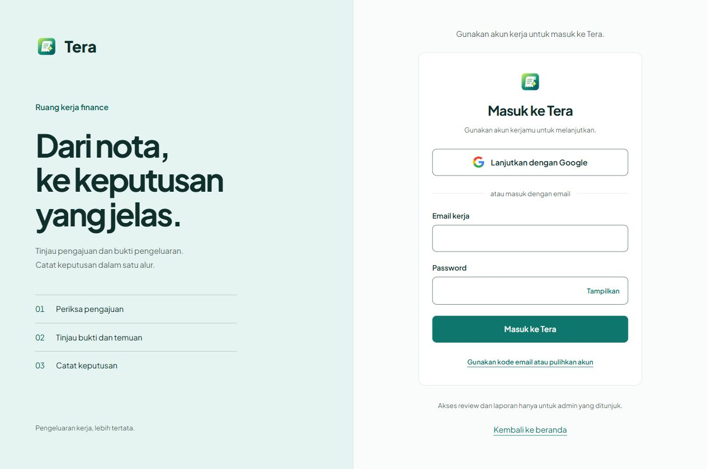

# Login dan akses klaim dengan Clerk

## Mode demo sementara

Login sementara ditahan sesuai permintaan pengguna. Pada backend `.env` lokal, `DEMO_MODE=true` memberi akses review/laporan tanpa Clerk atau OTP. Antarmuka menampilkan **Mode demo · tanpa login**, dan `/login` mengarah ke `/reviews`.

Flag ini hanya diterima di development/test; startup dengan `ENVIRONMENT=production` ditolak. Mode demo memaksa penyimpanan memory, provider mock, kebijakan local, dan anomali rules. Checkpoint pemrosesan juga berada di memory. Data klaim demo hilang ketika backend direstart. Kredensial/database normal yang tertulis di `.env` tetap disimpan tetapi tidak digunakan selama mode demo aktif. Keputusan review dicatat atas nama `demo-reviewer`.

Untuk kembali ke login normal, set `DEMO_MODE=false`, restart backend, dan refresh frontend. Konfigurasi Clerk serta daftar admin tetap tersedia. Jangan gunakan mode demo untuk data asli atau deployment publik.

Tera memakai SvelteKit dan FastAPI. Frontend menggunakan SDK JavaScript resmi `@clerk/clerk-js`, bukan `@clerk/nextjs`. SDK dimuat hanya di browser. Formulir utama menampilkan email dan password bersamaan; keduanya dikirim langsung ke Clerk dengan strategi `password`. Tombol Google tetap tersedia. UI Clerk bawaan dipakai untuk pemulihan akun, kode email, dan verifikasi tambahan.

## Migrasi

Login password lokal, database sesi SQLite, dan endpoint login/logout lokal diganti oleh sesi Clerk. Sesi lokal lama tidak diterima lagi. Data klaim tetap memakai penyimpanan yang sudah ada. Identitas keputusan review sekarang memakai Clerk User ID yang diverifikasi.

## Konfigurasi

Frontend `.env`:

```dotenv
BACKEND_URL=http://127.0.0.1:8000
VITE_CLERK_PUBLISHABLE_KEY=pk_test_your_publishable_key
```

Backend `.env`:

```dotenv
FRONTEND_ORIGIN=http://localhost:5173
CLERK_ISSUER=https://your-instance.clerk.accounts.dev
CLERK_ADMIN_USER_IDS=user_your_admin_id
```

Publishable key dan issuer harus menunjuk application serta environment yang sama. FRONTEND_ORIGIN harus cocok dengan URL yang dibuka di browser, termasuk port. Di production gunakan key live, issuer production, origin HTTPS, dan konfigurasi Google OAuth production pada Clerk.

Tidak perlu secret key untuk integrasi ini. FastAPI mengambil public signing keys dari `CLERK_ISSUER/.well-known/jwks.json` dan memverifikasi token RS256, issuer, masa berlaku, authorized party, user ID, session ID, dan status sesi. Token tidak disimpan di localStorage.

## Membuat admin pertama

1. Buka `/login` dan buat akun lewat Google/email, atau buat/undang pengguna lewat menu Users di Clerk Dashboard.
2. Dari Users, salin User ID akun yang ditunjuk, berbentuk `user_...`.
3. Isi `CLERK_ADMIN_USER_IDS` pada backend `.env` lalu restart backend. Beberapa ID dipisahkan koma.
4. Muat ulang halaman setelah konfigurasi backend dimuat ulang. Admin diarahkan ke `/reviews`; karyawan ke `/pengajuan`.

Daftar kosong berarti tidak ada admin. Akun yang berhasil login tetapi belum ditunjuk sebagai admin memperoleh akses karyawan dan diarahkan ke `/pengajuan`. Jangan menetapkan admin berdasarkan email atau klaim yang dikirim browser.

Untuk membatasi pembuatan akun, atur mode undangan di Clerk Dashboard. Penyedia login ditentukan di Dashboard: aktifkan Google dan email dengan kode verifikasi, nonaktifkan Microsoft, phone, dan username sesuai keputusan pengguna. Tampilan branding Clerk mengikuti pengaturan resmi application; penghapusannya tidak dilakukan dengan menyembunyikan elemen CSS.

Password authentication juga harus aktif. Konfigurasi publik application saat diperiksa pada 2026-10-14 sudah mencantumkan `password` dalam `auth_config.first_factors`; tidak ada pengaturan dashboard yang diubah. Akun yang hanya terhubung lewat Google dapat memakai Google atau pemulihan akun untuk menyiapkan password sendiri.

Halaman `/sso-callback` menyelesaikan redirect Google melalui `clerk.handleRedirectCallback()`. Login password hanya mengaktifkan sesi ketika Clerk mengembalikan status `complete` dan session ID. Jika Clerk meminta MFA, Device Trust, reset password, atau langkah lain, aplikasi melanjutkan lewat komponen Clerk. Redirect sesi memakai `decorateUrl()` untuk dukungan Safari.

## Proteksi dan batasan

SvelteKit memverifikasi cookie `__session` ke backend sebelum merender halaman `/admin`, `/review`, `/reviews`, `/reports`, dan `/dashboard`. API review dan laporan memeriksa autentikasi serta daftar admin untuk setiap request. Permintaan browser menggunakan token terbaru dari `clerk.session.getToken()`; proxy meneruskan Authorization ke FastAPI. Unduhan CSV memakai mekanisme yang sama.

Logout memakai `clerk.signOut()`. Pemeriksaan backend menggunakan JWT berumur pendek, tanpa pengecekan status sesi online pada setiap request. Token yang sudah diterbitkan dapat berlaku sampai kedaluwarsa (ditambah toleransi waktu lima detik) setelah logout/pencabutan sesi. Menghapus user ID dari daftar admin langsung mencabut otorisasi setelah konfigurasi backend dimuat ulang.

Saat `DEMO_MODE=false`, seluruh API `/claims` memerlukan sesi Clerk. Identitas pemilik klaim dan penjawab klarifikasi berasal dari sesi terverifikasi, sehingga nilai `employee_id`/`answered_by` kiriman browser tidak bisa dipakai menyamar. Karyawan hanya melihat klaim sendiri; filter karyawan lain tidak memperluas akses. Detail, timeline, klarifikasi, proses ulang, dan penggantian nota memeriksa pemilik atau admin sebelum menjalankan layanan. Klaim milik orang lain memberikan 404 seperti klaim yang tidak ditemukan. Admin tetap dapat meninjau semua klaim dalam aplikasi ini.

Idempotency key pembuatan dibatasi per akun; key pemrosesan dibatasi per akun dan klaim. Respons duplikasi kepada karyawan menyembunyikan ID/evidence klaim lain, termasuk pada keputusan dan timeline. Data lengkap tetap tersedia untuk admin. Riwayat frontend memakai identitas sesi; unduhan laporan CSV tetap khusus admin. Halaman `/pengajuan`, `/riwayat`, dan `/claims` memerlukan login di mode normal, dan akun karyawan yang membuka halaman admin menerima 403.

Klaim lama dengan identitas contoh seperti `salesman-001` tetap hanya dapat diakses admin dalam mode normal. Tidak ada pemindahan kepemilikan otomatis berdasarkan email atau identitas dari browser. Mode demo mempertahankan identitas contoh dan akses terbuka pada penyimpanan memory terpisah.

Cakupan ini adalah satu perusahaan. Pemisahan tenant/perusahaan, migrasi kepemilikan data lama, pengujian PostgreSQL pada database tes, dan konfigurasi adapter/hosting produksi masih perlu diselesaikan sebelum penggunaan produksi.

## Referensi

- [Quickstart JavaScript Clerk](https://clerk.com/docs/js-frontend/getting-started/quickstart)
- [Verifikasi JWT Clerk](https://clerk.com/docs/guides/sessions/manual-jwt-verification)
- [Komponen SignIn](https://clerk.com/docs/js-frontend/reference/components/authentication/sign-in)

## Hasil validasi 2026-10-14

- Backend: 435 tes lulus, 24 dilewati. Integrasi PostgreSQL memerlukan konfigurasi database tes terpisah. Setelah penyederhanaan konfigurasi checkpoint, 26 tes autentikasi/demo juga dijalankan ulang dan lulus.
- Frontend: 47 tes lulus, svelte-check tanpa error/peringatan, dan build produksi berhasil. Delapan tes mencakup formulir password satu langkah dan status autentikasi belum lengkap; satu tes tambahan memastikan mode demo melewati pemuatan Clerk dan mode normal mengaktifkannya kembali.
- Mode demo: pemeriksaan HTTP tanpa cookie/token memverifikasi `/login` mengarah ke `/reviews`, halaman review/laporan serta API/CSV merespons 200, label demo muncul, dan kontrol akun Clerk tidak dirender. Pemeriksaan visual browser ulang belum dijalankan; validasi kali ini memakai HTTP server, tes perilaku, dan build.
- Formulir email/password: kedua field langsung terlihat pada halaman yang sama; password berada di bawah email, masing-masing setinggi 48px. Pemeriksaan pada 320, 375, 414, 768, dan 1280px tidak menemukan horizontal overflow.
- Browser pada origin lokal terpisah menguji tampilkan/sembunyikan password, respons gagal dengan akun sintetis, membuka alur kode email/pemulihan Clerk, dan kembali ke formulir password. Sesi pengguna yang aktif pada localhost tidak diubah. Keberhasilan login password dengan akun nyata tidak diuji karena pengguna sudah memiliki sesi aktif.
- Public JWKS application yang dikonfigurasi berhasil diakses dan memiliki satu signing key. Tidak ada secret key yang diperlukan atau ditambahkan.
- Browser: komponen Clerk memuat Google dan email dari application Tera, judul/label diterjemahkan ke bahasa Indonesia, formulir kosong ditolak, dan fokus keyboard terlihat.
- Responsivitas: 320, 375, 414, 768, dan 1280px tanpa horizontal overflow. Padding kartu diperbaiki agar label Google terbaca penuh pada 320px.
- Membuka `/reviews` tanpa sesi mengarah ke `/login`. Tidak ada error console pada pemeriksaan browser.
- JWT sintetis dengan tanda tangan RSA menguji masa berlaku, issuer/authorized party salah, algoritma yang tidak diizinkan, pemalsuan tanda tangan, status sesi pending, cookie/header, outage JWKS, pengguna non-admin, dan identitas reviewer dari sesi.
- Transport frontend menguji token terbaru, unduhan CSV, konfigurasi salah, retry, SSR, serta pencegahan pengiriman token ke URL eksternal.
- User ID admin yang diberikan pengguna telah disimpan di backend `.env` lokal dan diperiksa lewat Settings; konfigurasi serta kedua `.env` diabaikan Git.
- Login OAuth/email dan logout dengan akun nyata belum dilakukan oleh agen. Pengguna perlu menyelesaikan autentikasi sendiri untuk pemeriksaan akhir alur akun nyata.

### Pemeriksaan desain (cakupan halaman Tera)

- Hard Gate PASS untuk pemeriksaan yang dapat dijalankan: komponen nyata, validasi kosong, loading/error/retry, fokus, responsivitas, dan build. Alur OAuth/email serta logout akun nyata masih menunggu pengguna sebagaimana dicatat di atas.
- Purpose Gate PASS: panel mint membedakan konteks kerja dari formulir, tiga baris menjelaskan tugas reviewer yang nyata, logo memakai aset yang sudah ada. Tombol utama tidak memakai gradient atau shadow dekoratif.
- Liveliness PASS: ENERGY 2 / RHYTHM 2 / MOTION 1 mengikuti DESIGN.md; desktop membagi konteks dan tindakan, mobile memprioritaskan formulir, logo dan tipografi memakai identitas Tera.
- Craftsmanship PASS pada pemeriksaan visual dan keyboard: label Google terbaca di 320px, fokus terlihat, tombol utama minimal 44px, dan `.env` tidak masuk Git. Banner development berasal dari Clerk dan tetap terlihat pada development instance.




## Validasi pembatasan kepemilikan

Tes dengan JWT RSA sintetis mencakup dua karyawan dan admin pada memory/SQLite: pemalsuan identitas, filter riwayat, semua endpoint tanpa sesi, pembacaan/perubahan klaim asing, replay idempotency lintas akun, error duplikasi, privasi evidence duplikasi, identitas jawaban klarifikasi, dan penolakan origin lain. Tes frontend mencakup guard halaman karyawan/admin, mode demo, layanan sesi gagal, serta token baru untuk API klaim dengan query string. Login akun nyata tetap belum diuji otomatis; demo lokal tetap aktif.
