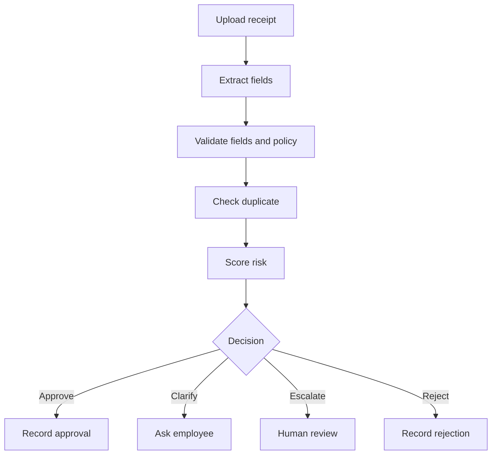

# Agent Flow

The implemented processing flow is:

Intake saves receipts before processing begins. Clarification resumes processing
with the stored answer; human review applies a new decision without repeating
extraction. The workflow also records policy evaluation separately from field
validation. Completed requests replay stored outcomes.

See [[agent-modules|Agent module boundaries]] for graph modules and responsibilities.

Related documents:

- [[overview|Architecture overview]]
- [[../BRD_Expense_Reimbursement_Agent|Business requirements]]
