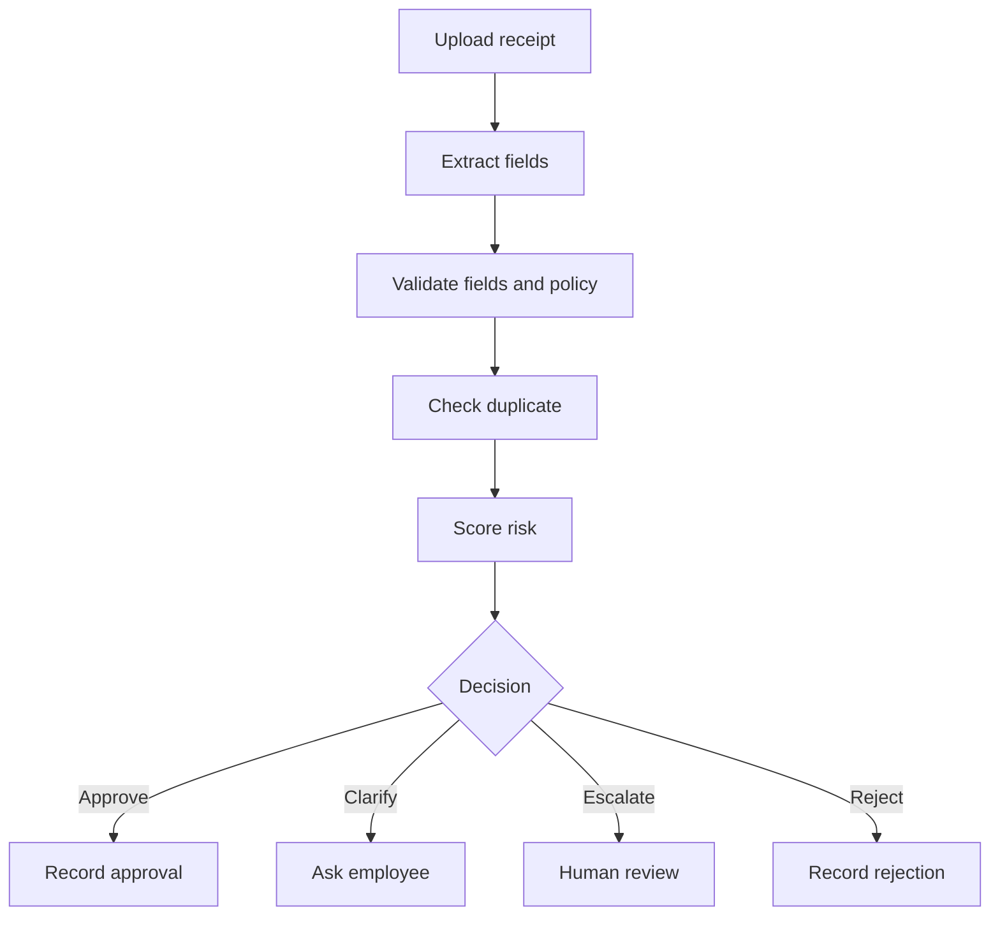

# Agent Flow

The target claim flow is:

The flow is a target architecture, not a claim that all steps are already implemented.

Related documents:

- [[overview|Architecture overview]]
- [[../../BRD_Expense_Reimbursement_Agent|Business requirements]]
