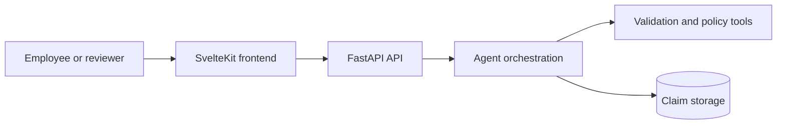

# Architecture Overview

The prototype is a monorepo with a SvelteKit frontend and a FastAPI backend.

The current implementation contains only the API health check and frontend foundation. The remaining components are introduced incrementally.

Related documents:

- [[../README|Documentation index]]
- [[agent-flow|Agent flow]]
- [[../decisions/0001-monorepo|Monorepo decision]]
