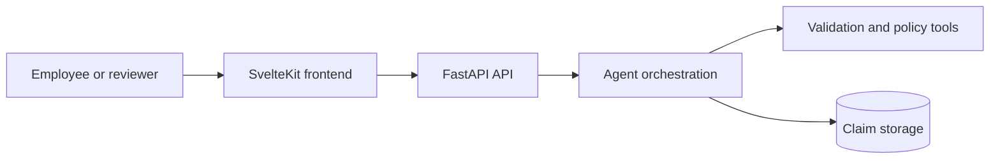

# Architecture Overview

The prototype is a monorepo with a SvelteKit frontend and a FastAPI backend.

The backend implements claim intake, extraction, validation, policy evaluation,
duplicate detection, rule-based anomaly scoring, decisions and human clarification
or review. LangGraph coordinates the processing steps; repositories store domain
records and a separate checkpoint runtime supports waiting-state resume.

See [[agent-modules|Agent module boundaries]] for the current source layout,
dependency flow and checkpoint compatibility constraints.

Related documents:

- [[../README|Documentation index]]
- [[agent-flow|Agent flow]]
- [[../decisions/0001-monorepo|Monorepo decision]]
