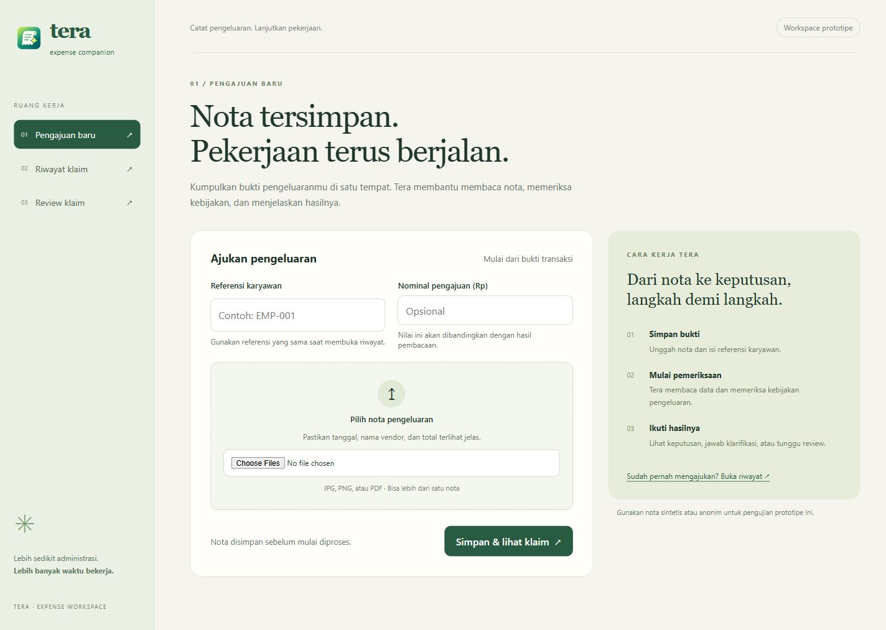

# Claim workspace validation — 2026-10-11

## Scope and baseline

The original home/history pages were placeholders. The review page used fixture
claims and browser-only decisions; `pnpm check` reported 19 errors and two warnings.
The issue #12 API regression reproduced an unhandled Decimal exception when
mapping a model total of `1e30`.

## Automated verification

- `backend/.venv/Scripts/python.exe -m pytest -q`: **362 passed, 24 skipped**.
  PostgreSQL and pgvector integration cases require a disposable test database
  server via `TEST_POSTGRES_URL`; these were not verified against a live server.
- Numeric regressions exercise the real claim API with an injected live adapter:
  extreme totals/quantities, precision limits, persisted FAILED runs, keyed replay,
  retry with corrected output, and no raw output in response/logs.
- `pnpm check`: **0 errors, 0 warnings**.
- `pnpm build`: passed. Adapter-auto still requires selecting a supported
  deployment environment before deployment, as in the existing setup.

## Local smoke verification

Used a separate API on `127.0.0.1:8011` with `STORAGE_BACKEND=memory`,
`PROVIDER_MODE=mock`, `POLICY_MODE=local`. Frontend `BACKEND_URL` pointed there;
application PostgreSQL data and local `.env` files were not modified.

Through the frontend `/api` proxy, checked intake replay with the same key,
duplicate receipt HTTP 409, participant clarification, amount escalation, policy
rejection, malformed extraction HTTP 502 and retry, history scoping/empty
results, timeline retrieval, UUID validation, and rejection of unsupported paths.

Browser checks using synthetic PNG receipts:

- Save upload → open persisted detail → explicitly process → approved.
- Answer participant clarification with `2` → new run → approved; answer history
  remains visible and the input disappears when no clarification remains open.
- Open review queue → inspect detail → enter reviewer/reason → cancel
  confirmation → confirm decision → persisted reviewer approval.
- Search employee history → approved claim appears → rejected-status filter
  shows an explicit empty state.
- Malformed claim → retry → visible localized error; retry remains enabled,
  and no successful decision is displayed.
- Responsive home checked at desktop and mobile widths without horizontal
  page overflow. Native keyboard focus styles and confirmation focus are present.

Backend explanations are displayed verbatim and may remain in English; navigation,
labels, status badges and request errors use Indonesian. Employee/reviewer
references are identifiers, not authentication. No receipt bytes or identities
are stored in browser localStorage. No ML/reporting changes are included.

