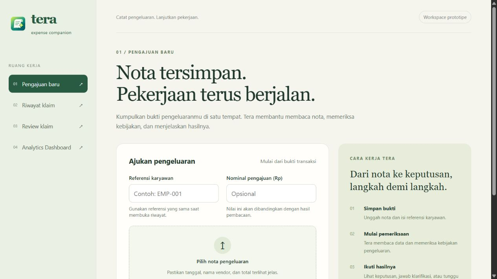

# PR #21 integration with main

Merged `origin/main` at `e0ca85d` into `feat/claim-workspace` to incorporate PR #8.

## Conflict decisions

- Keep PR #21's upload form and Tera sidebar; add `04 Analytics Dashboard`.
- Keep the review queue linked to `/claims/{id}#review`. That detail workspace
  already supplies evidence, reviewer identity, reason and a confirmation step.
  Do not retain a competing modal-based decision flow.
- Keep the workspace status colors and labels; preserve the incoming optional
  badge size and distinguish statuses with glyphs as well as text.
- Preserve the dashboard, formatters and typed clients from main. Route every
  client through `/api`, and share contracts from `lib/types/claim.ts`.
- Link actual dashboard claim rows to `/claims/{id}`. Sample dashboard metrics
  remain prototype behavior and are outside this conflict-resolution scope.
- Keep unknown upstream error messages generic rather than exposing raw payloads.

## Verification

- Backend: 362 passed, 24 skipped. PostgreSQL/pgvector integration requires
  `TEST_POSTGRES_URL`; application databases were not used for this verification.
- Frontend check: zero errors and warnings; production build succeeds.
- Frontend API/formatter tests include shared proxy transport and generic unknown
  upstream-error handling.
- Built frontend proxy smoke with an isolated memory/mock backend: synthetic
  upload, processing, clarification/resume, reviewer decision, detail pages,
  employee-filtered history and rejection of disallowed proxy routes passed.
- Browser inspection verified the upload workspace and dashboard navigation.

