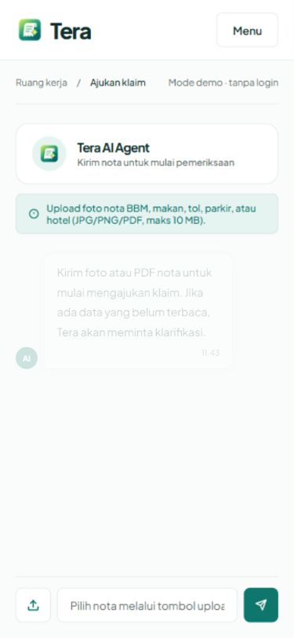
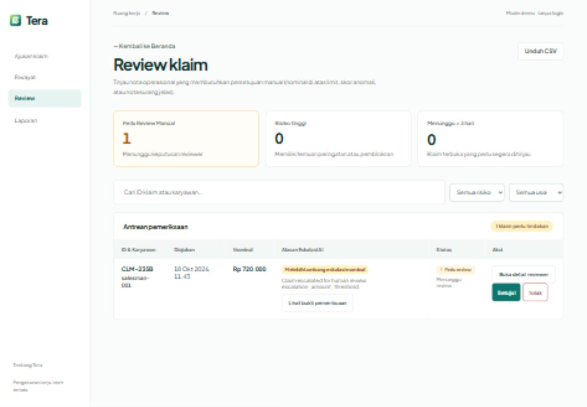

# Audit UI Tera, 18 Oktober 2026

Arah mengikuti DESIGN.md yang sudah disetujui: workbench modern-minimal,
Plus Jakarta Sans, teal/mint, ENERGY 2 / RHYTHM 2 / MOTION 1. Perubahan
memperbaiki alur yang ada, tanpa mengubah identitas produk atau kebijakan klaim.

## Temuan dan perbaikan

1. **Nota terpilih tidak terkirim.** Tombol Kirim hanya memanggil alur pesan
   teks; submitClaim hanya terjangkau lewat tombol retry. Reproduksi browser:
   pilih PNG sintetis, tekan Kirim, muncul "Tulis pesan terlebih dahulu".
   Sekarang file terpilih diprioritaskan untuk upload, termasuk nota pengganti.
   Tombol nonaktif selama pengiriman/proses dan bernama aksesibel "Kirim nota".
2. **Composer keluar viewport.** Tinggi chat dihitung tanpa memperhitungkan
   seluruh header workspace. Sebelum perubahan, tombol berakhir pada y=672.8
   di viewport setinggi 660. Sekarang shell chat membagi ruang lewat flex;
   pesan yang menggulir dan composer tetap dalam ruang yang tersedia.
3. **Escape tidak menutup menu.** Sekarang Escape menutup menu workspace dan
   mengembalikan fokus ke tombol Menu. Navigasi dengan tautan tetap menutupnya.
4. **Status Online tidak berdasarkan koneksi.** Diganti status aktivitas lokal:
   siap menerima nota, memproses nota, atau menunggu klarifikasi. Tidak ada klaim
   kesehatan provider. Logo yang sudah ada menggantikan ikon robot dekoratif.
5. **Teks kosong dan tombol ikon kurang jelas.** Tombol kirim/penutup dialog
   memiliki nama aksesibel, error composer terhubung lewat aria-describedby,
   dan timestamp/placeholder memakai warna teks terbaca tanpa opacity 0.5.
6. **Filter Selesai tidak sesuai API.** Endpoint reviews hanya memuat review
   terbuka. Filter/count selesai dihapus; ringkasan memakai jumlah antrean,
   temuan warning/blocking, dan usia minimal tiga hari dari data antrean.
7. **Konfirmasi alasan kosong.** Tombol konfirmasi nonaktif sampai alasan
   berisi teks. Field wajib ditandai dan textarea detail mendapat aria-label.
8. **Pesan bebas hanya bergema.** Petunjuk sekarang menjelaskan pemilihan
   nota dan fungsi teks untuk klarifikasi; tidak mengesankan chat LLM umum.

## Bukti browser dan batas pengujian

Backend demo terpisah pada localhost:8005, memori sementara, provider mock;
frontend audit pada localhost:5175. Konfigurasi .env/login asli tidak diubah.
PNG buatan untuk uji bertuliskan SYNTHETIC UI TEST ONLY, bukan nota pribadi.

- Upload melalui browser berhasil membuat klaim, mengarahkan ke detail, lalu
  tombol Mulai pemeriksaan menyelesaikan proses mock dan menampilkan keputusan.
- Satu klaim sintetis nominal tinggi diuji melalui review detail; keputusan
  backend tampil setelah konfirmasi. Perilaku ini juga mencakup perbaikan
  lokal dari PR #31, yang tidak disertakan ulang di PR UI ini.
- Dialog bukti dan konfirmasi dibuka/ditutup, fokus kembali ke pemicu.
  Konfirmasi tanpa alasan nonaktif; setelah alasan diisi menjadi aktif.
- Filter risiko/usia diuji, termasuk hasil kosong. Error composer kosong
  diumumkan dengan role alert, aria-invalid dan aria-describedby.
- Pengajuan, riwayat, review, laporan, dashboard diperiksa pada lebar 320,
  375, 414, 768, 1440. Lebar dokumen tidak melebihi viewport. Pada pengajuan,
  bagian bawah tombol Kirim berada di y=792 untuk tinggi 812, dan y=980
  untuk tinggi 1000. Tabel panjang tetap berada di wadah scroll-nya.
- Konsol browser pada akhir sesi tidak mencatat error baru.

Audit ini bukan bukti akurasi OCR/LLM, uji login Clerk nyata, atau semua kondisi
produksi. Antrean yang berubah bersamaan dan kinerja daftar besar tetap mengikuti
batas API yang ada. File chooser otomatis sangat lambat dalam sesi ini; waktu
tersebut tidak dipakai sebagai pengukuran kecepatan upload aplikasi.

## Gate untuk perubahan UI ini

- Hard gate PASS: tidak ada metrik/status koneksi yang dibuat-buat pada elemen
  yang diperbaiki; 25 kombinasi halaman/lebar tanpa overflow dokumen; upload dan
  tombol berubah diuji dengan data sintetis. Loading/empty/error tetap tersedia.
- Purpose PASS: teal menunjukkan tindakan, mint menunjukkan informasi; grid
  workspace dan scroll pesan dipertahankan untuk keterbacaan; logo produk sudah
  ada. Tidak menambah gambar, identitas, testimonial atau motion dekoratif.
- Liveliness PASS: tiga dial mengikuti DESIGN.md, heading/aksi utama tetap
  jelas, font brand dan jarak workspace dipertahankan.
- Human/mobile PASS: Escape dan pemulihan fokus diverifikasi, nama tombol
  ikon dan error input diperiksa di accessibility tree, target composer
  minimal 44px, reflow diuji pada lima lebar.
- Craft PASS: perubahan difokuskan pada kontrol/alur bermasalah dan API tetap
  sumber keputusan. Screenshot dan hasil pemeriksaan tersedia di bawah.

## Screenshot

## Validasi kode

Checkout PR bersih: 29 tes frontend lolos; Svelte check 0 error dan 0 warning.
Build produksi dan diff-check dijalankan sebelum PR dibuat. Checkout kerja juga
memuat perubahan login dan perbaikan review terpisah; hasil tesnya dilaporkan
terpisah, bukan dianggap sebagai jumlah tes pada PR bersih.
