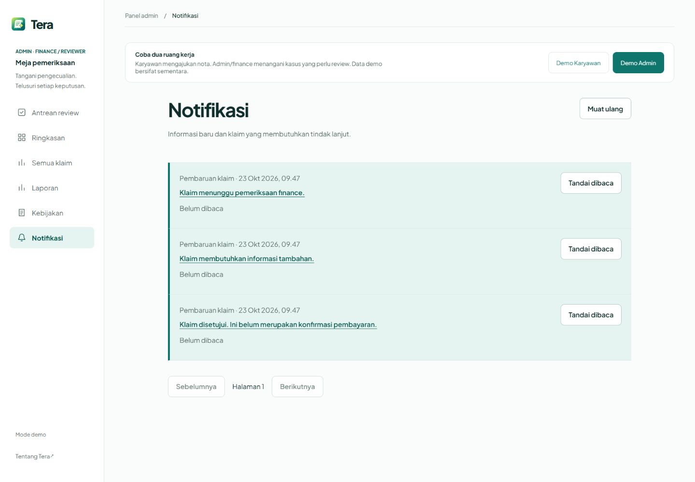
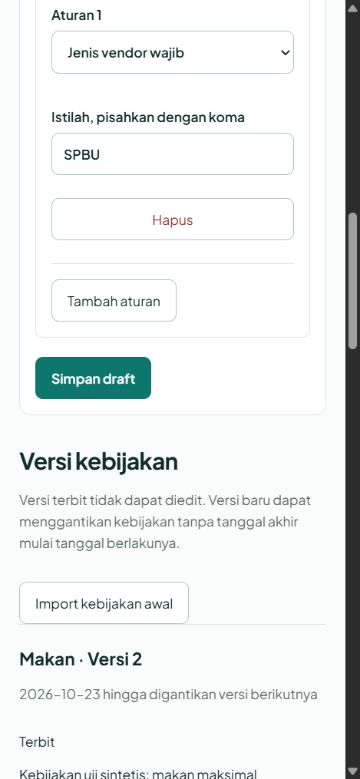

# Audit antarmuka setelah implementasi

Mode: **after**, pilihan eksplisit pengguna pada sesi ini. Scope: inbox `/notifikasi`, editor `/admin/policies`, tambahan metrik `/reports` dan navigasinya. Audit ini bukan sertifikasi seluruh aplikasi atau pengujian akun Clerk nyata.

## Arah dan alasan desain

Meneruskan DESIGN.md: ruang kerja reimbursement berbahasa Indonesia untuk karyawan dan finance, teal/mint, Plus Jakarta Sans, ENERGY 2 / RHYTHM 2 / MOTION 1. Pernyataan arah implementasi mempertahankan identitas aplikasi yang sudah ada.

| Keputusan | Tujuan |
|---|---|
| Teal untuk tindakan/tautan, mint untuk belum dibaca | Menunjukkan tindakan dan status yang perlu perhatian tanpa menambah palet baru |
| Form kebijakan dan daftar versi berbeda komposisi | Memisahkan pekerjaan menyusun aturan dari pemeriksaan publikasi |
| Baris inbox dengan garis status | Memudahkan pemindaian notifikasi belum dibaca; garis memiliki arti status |
| Tipografi dan navigasi yang sudah ada | Menjaga kontinuitas ruang kerja Tera |
| Jarak antarkelompok form | Memisahkan kategori, masa berlaku, sumber dan aturan |
| Ikon dokumen/lonceng | Menandai tujuan kebijakan dan notifikasi, bukan dekorasi AI |
| Tanpa animasi masuk baru | Mengutamakan pembacaan nota dan pengambilan tindakan |

Tidak ada logo, avatar, ilustrasi atau aset pemasaran baru yang dibuat. Screenshot adalah bukti aplikasi berjalan dengan fixture sintetis.

## Temuan bernomor

Tidak ditemukan temuan baru yang membutuhkan koreksi pada scope yang diperiksa (HIGH 0, MEDIUM 0, LOW 0). Tidak ada perubahan UI yang dilakukan atas dasar audit ini. Hasil berlaku pada rute, viewport dan keadaan yang diuji di bawah; bukan jaminan semua perangkat atau teknologi bantu.

## Delivery Gate

| Kelompok | Hasil pada scope | Bukti |
|---|---|---|
| Hard Gate | Lulus | Tidak ada klaim akurasi/biaya rekaan, aset asumsi atau CTA kosong; data demo diberi label; estimasi waktu berlabel asumsi |
| Purpose Gate | Lulus | Alasan visual tertulis di atas; tidak ada glow/gradient/glass/animasi template baru; garis inbox menyampaikan status |
| Liveliness | Lulus | Dials eksplisit; judul dan tindakan utama jelas; form/list/metrik mengikuti isi; motif teal/mint dan tipografi konsisten |
| Craftsmanship | Lulus dalam pengujian | Simpan/publish/audit, read/refresh/deep-link, review/CSV, menu keyboard, retry dan empty state berjalan |

Browser lokal diuji pada 1440×1000 dan 375×812. Pada viewport 375, lebar dokumen terukur 360 sehingga tidak ada overflow horizontal. Menu mobile dapat ditutup dengan Escape dan fokus kembali ke pemicunya. Form memiliki label dan input native; tombol review tanpa alasan tetap disabled. Jalur error diuji dengan menghentikan backend, melihat pesan kegagalan, lalu menyalakannya kembali: **Coba lagi** menampilkan empty state, kemudian **Muat ulang** menampilkan fixture baru.

Perhitungan luminance sRGB memberi kontras teal `#0f766e` pada putih 5,47:1, teks `#102e2b` pada putih 14,51:1 dan teal pada mint `#e5f3f0` 4,80:1. Ini pemeriksaan pasangan warna tersebut, bukan audit WCAG menyeluruh.

Frontend: 83 tes lulus, pemeriksaan Svelte/TypeScript 0 error/0 warning dan build produksi berhasil. Browser akun nyata, screen reader dan UAT pengguna belum dinyatakan lulus.

