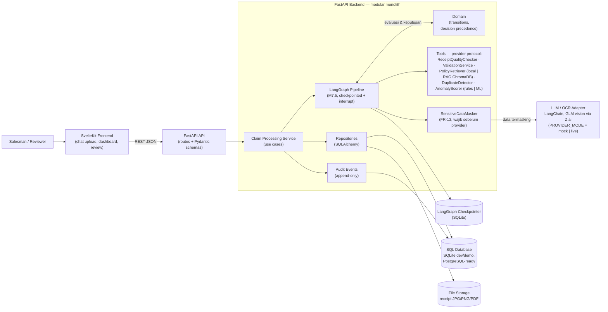
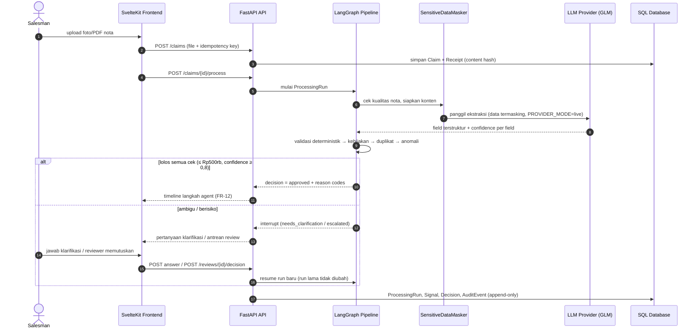
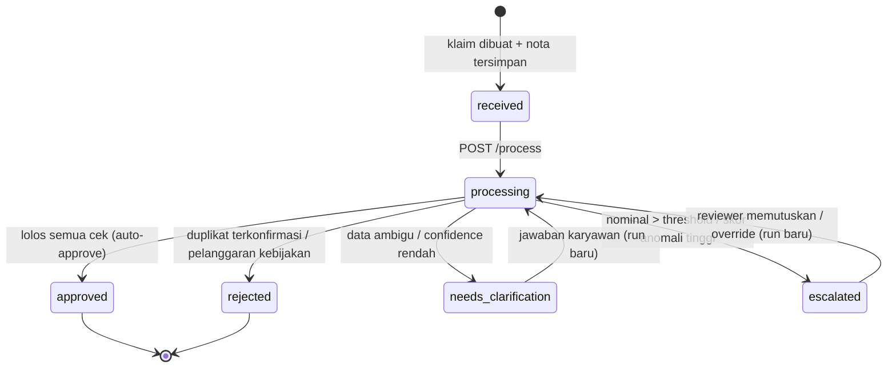

# SDD — System/Software Design Document — Expense Agent

> **Fungsi dokumen:** rancangan teknis — arsitektur, komponen, teknologi, keamanan. Menjadi acuan teknis agar kode konsisten dengan rancangan. Rancangan ini sudah (dan terus) diikuti implementasi backend M0–M6 serta rencana M7/M7.5/M7.6/M8.

| | |
|---|---|
| **Sistem** | Expense Agent |
| **Berdasarkan** | [[07-srs|SRS v1.0]] |
| **Versi / tanggal** | v1.0 / 2026-10-05 |

## 1. Arsitektur Sistem

Pola yang dipilih: **modular monolith client-server 3-tier** dengan **port/adapter** di batas repositori dan provider eksternal — HTTP (FastAPI) → service/use case → domain deterministik → integrasi via protocol. Frontend SvelteKit terpisah di monorepo yang sama ([[../decisions/0001-monorepo|ADR 0001]]).

📄 Sumber: [`docs/diagrams/architecture.mmd`](../diagrams/architecture.mmd) · Hasil render: [`architecture.svg`](../diagrams/architecture.svg)

**Komponen & tanggung jawab:**

| Komponen | Tanggung jawab | Teknologi |
|----------|----------------|-----------|
| Frontend | Interaksi salesman/reviewer: upload nota, percakapan klarifikasi, antrean review, timeline langkah agent, laporan | SvelteKit + TypeScript |
| API | Transport HTTP; validasi input/output via Pydantic; tanpa logika bisnis | FastAPI |
| Services | Use case klaim: intake, pemrosesan, klarifikasi, review, laporan; orkestrasi pipeline via LangGraph (M7.5) dengan interrupt + checkpointer | Python |
| Domain | Aturan bisnis deterministik: transisi status, precedence keputusan konservatif, reason codes | Python murni (tanpa dependensi transport/DB) |
| Repositories | Menyembunyikan detail persistensi di balik protocol; implementasi SQL (SQLAlchemy) dan memory (untuk test) | SQLAlchemy 2.0 |
| Integrations | Satu-satunya tempat yang mengenal provider eksternal: LLM/OCR (LangChain, GLM vision via Z.ai), RAG policy (ChromaDB + sentence-transformers), anomali ML (scikit-learn), file storage, masking | Adapter di balik protocol (`ReceiptExtractor`, `PolicyRetriever`, `AnomalyScorer`, `SensitiveDataMasker`, `FileStorage`, dst.) |
| Audit | Pencatatan event append-only dengan sequence per aggregate; tidak pernah mengubah keputusan | SQLAlchemy + unique constraint |
| Database & storage | Persistensi klaim, run, signal, decision, audit; file nota | SQLite (dev/demo) via `DATABASE_URL`, siap PostgreSQL; file storage BLOB/memory |

**Justifikasi pilihan teknologi** (kenapa bukan alternatif lain):

| Keputusan | Alternatif yang dipertimbangkan | Alasan memilih |
|-----------|--------------------------------|----------------|
| FastAPI | Django, Flask | Kontrak Pydantic tervalidasi otomatis, async, ringan untuk API prototipe; selaras kebutuhan skema input/output tervalidasi |
| SvelteKit + TypeScript | React/Next.js, Vue | Ringan dan cepat dikembangkan tim kecil; TS menjaga kontrak FE↔BE |
| LangGraph sebagai orkestrator (M7.5) | Orkestrator buatan sendiri | `interrupt()` + checkpointer memetakan langsung ke klarifikasi (FR-09) dan eskalasi (FR-10) tanpa mengubah outcome; graph membungkus service yang sudah ada — tanpa logika bisnis baru ([[../decisions/0002-langchain-langgraph-stack|ADR 0002]]) |
| LangChain + GLM vision via Z.ai (OpenAI-compatible) | SDK provider spesifik, provider lain | Structured output mengalir lewat boundary validasi Pydantic yang sama; endpoint OpenAI-compatible fleksibel; `PROVIDER_MODE=mock\|live` menjaga pengujian deterministik |
| ChromaDB + sentence-transformers (multilingual MiniLM) | pgvector, FAISS, LLM-native retrieval | Lokal, mudah di-seed, multilingual; retrieval **hanya memilih** policy — evaluasi tetap deterministik; retrieval miss fallback ke local store |
| Isolation Forest (scikit-learn) | Deep learning / library besar | Dataset sintetis kecil; deterministik (fixed random state); skor dapat dijelaskan beserta versi model pada setiap Signal |
| SQLite → PostgreSQL via `DATABASE_URL` | PostgreSQL sejak awal | Nol-konfigurasi untuk demo dan CI; skema SQL portabel; naik kelas tanpa mengubah kode aplikasi |

## 2. Deployment & Environment

| Environment | Tujuan | Lokasi/hosting | Akses |
|-------------|--------|----------------|-------|
| Development | Coding & unit test | Lokal: `uvicorn app.main:app --reload` + `pnpm dev`; SQLite; `PROVIDER_MODE=mock` | Developer |
| Demo/Production | Live link untuk juri GTNIC | PaaS publik berbasis container (kandidat: Render/Railway/Fly.io — **belum diputuskan**, wajib fix sebelum 4 Nov 2026); `PROVIDER_MODE=live` dengan kunci API di environment variable | Publik (data sintetis saja) |

Status jujur per 2026-10-06: deploy belum dilakukan; backend M0–M7 teruji (96 test) di branch `feat/backend-privacy-integrations` menunggu review/merge — M7 mencakup masking FR-13, ekstraksi LLM LangChain (GLM-4.5V via Z.ai, `PROVIDER_MODE=mock|live`), dan fallback provider. Mode live hanya struk JPG/PNG (foto HP); struk PDF live ditunda dengan alasan di spec M7. Uji asli ke endpoint LLM (smoke test ber-key) belum pernah dilakukan. Orkestrasi LangGraph (M7.5), RAG+ML (M7.6), dan reporting (M8) dijadwalkan 19 Okt – 4 Nov sesuai rencana kerja [[05-brd|BRD]].

## 3. Alur Data / Sequence (Alur Kritis)

Alur paling kritis: satu klaim dari upload sampai keputusan + persistensi, termasuk interrupt klarifikasi/eskalasi (detail interrupt: [[../superpowers/specs/2026-10-05-expense-agent-backend-m75-langgraph-orchestration-spec|spec M7.5]]).

📄 Sumber: [`docs/diagrams/flow-claim-processing.mmd`](../diagrams/flow-claim-processing.mmd) · Hasil render: [`flow-claim-processing.svg`](../diagrams/flow-claim-processing.svg)

Lifecycle status klaim (keputusan terminal immutable; koreksi = event baru):

📄 Sumber: [`docs/diagrams/state-claim-lifecycle.mmd`](../diagrams/state-claim-lifecycle.mmd) · Hasil render: [`state-claim-lifecycle.svg`](../diagrams/state-claim-lifecycle.svg)

**Precedence keputusan (konservatif, tidak boleh dilunakkan oleh graph/provider):** (1) data invalid/missing → `needs_clarification`; (2) duplikat terkonfirmasi → `rejected` kecuali override manusia; (3) pelanggaran kebijakan → `rejected`; (4) risiko tinggi/confidence rendah/nominal di atas ambang → `escalated`; (5) hanya klaim lolos semua cek → `approved`. Setiap keputusan menyimpan reason codes, signal yang dipakai, policy version, dan processing run.

## 4. Keamanan

- **Autentikasi:** tidak ada auth penuh pada prototipe — identitas karyawan berupa ID eksternal; keterbatasan ini dinyatakan eksplisit di BRD/SRS dan pada live link demo.
- **Otorisasi:** antarmuka review hanya di sisi peran reviewer pada UI prototipe; setiap aksi reviewer tercatat sebagai Decision/Review baru dengan aktor yang dapat diaudit.
- **Proteksi data:**
  - `SensitiveDataMasker` berjalan di kode kita **sebelum** konten apa pun mencapai model LangChain/provider — tanpa kecuali (FR-13).
  - Byte nota dan payload ber-sekret **tidak pernah** masuk log, checkpointer, atau audit payload; hanya metadata aman.
  - Kunci API hanya di `.env` (hanya `.env.example` yang di-commit); repo bebas data pribadi asli — semua fixture sintetis/anonim.
- **Validasi input & mitigasi:** validasi tipe/ukuran file (≤ 10 MB) di intake; skema Pydantic untuk semua kontrak; akses DB via ORM/SQLAlchemy (parameterized, mencegah SQL injection); CORS dibatasi `FRONTEND_ORIGIN`; audit events append-only dengan unique constraint per aggregate; guardrail: provider tidak pernah menentukan keputusan final — evaluasi kebijakan dan precedence tetap deterministik.

## 5. Skala & Performa

- **Estimasi beban:** beban target demo = ±1.800 klaim/bulan (perusahaan fiktif), single instance; klaim standar < 30 detik end-to-end; endpoint non-pipeline < 2 detik.
- **Strategi jika tumbuh:** indeks pada kolom filter utama (status, employee_id, claim_id, content_hash, aggregate audit); idempotency keys mencegah duplikasi di bawah konkurensi; fallback provider + pemanggilan berbatas; migrasi SQLite → PostgreSQL via `DATABASE_URL` saat beban menuntut; arsip audit event tua bila tumbuh besar.

## 6. Keputusan Desain Penting (ADR Ringkas)

| # | Keputusan | Konteks | Konsekuensi |
|---|-----------|---------|-------------|
| D-01 | Monorepo backend+frontend | [[../decisions/0001-monorepo|ADR 0001]] | Satu tempat untuk kontrak FE↔BE; CI menyatukan test kedua sisi |
| D-02 | Adopsi LangChain, LangGraph, RAG, ML anomaly | [[../decisions/0002-langchain-langgraph-stack|ADR 0002]] | `integrations/` satu-satunya tempat yang mengenal library; dependencies pinned per milestone; mode mock menjaga determinisme |
| D-03 | Deterministik dulu, AI memperkaya | Urutan milestone M0→M8 (M7 sengaja terlambat) | Pipeline stabil lulus 85+ test sebelum LLM menyentuhnya; provider gagal tidak pernah memutuskan klaim |
| D-04 | Precedence keputusan konservatif + keputusan terminal immutable | Keamanan klaim bernilai besar | Keputusan deterministik per (input, policy version); koreksi/override = event baru, tidak pernah overwrite |
| D-05 | Masking wajib sebelum boundary provider eksternal | BR-05 / FR-13 | Bukti lewat masking test; data sensitif tidak pernah keluar sistem tanpa perlindungan |
| D-06 | Persistensi atomik + idempotency + audit sequence per aggregate | M6 (teruji: concurrency, idempotency, timeline regression) | Pengulangan request tidak menghasilkan duplikat; klaim dapat direkonstruksi dari timeline |
