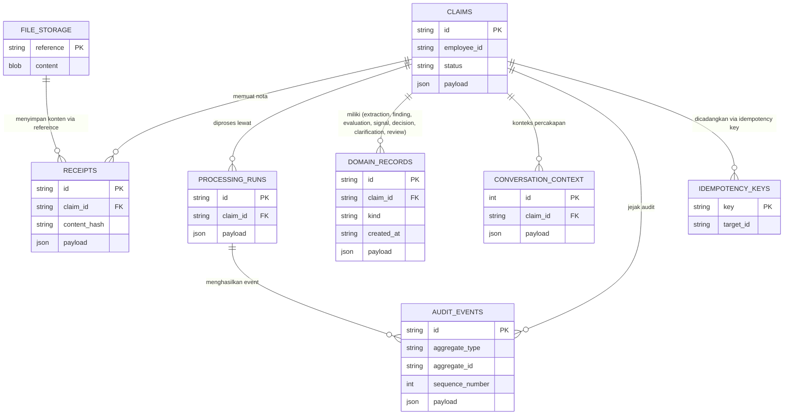

# Database & File Design — Expense Agent

> **Fungsi dokumen:** rancangan struktur data — ERD, spesifikasi tabel, relasi, indeks, dan kebijakan file/backup. Dokumen ini mengikuti implementasi persistensi M6 (as-built) sekaligus acuan migrasi lanjutan.

| | |
|---|---|
| **Sistem** | Expense Agent |
| **DBMS** | PostgreSQL via SQLAlchemy 2.0 + psycopg; SQLite tetap didukung untuk legacy/test |
| **Versi dokumen** | v1.0 / 2026-10-05 |

## 1. ERD (Entity Relationship Diagram)

Satu tabel induk `claims` dengan tabel anak per-klaim; record domain anak (extraction, finding, evaluation, signal, decision, clarification, review) disimpan pada tabel generik `domain_records` yang dibedakan kolom `kind` (pola class-table-inheritance ringkas).

📄 Sumber: [`docs/diagrams/erd.mmd`](../diagrams/erd.mmd) · Hasil render: [`erd.svg`](../diagrams/erd.svg)

## 2. Spesifikasi Tabel

> Definisi kolom mengikuti implementasi `backend/app/repositories/sql.py`. ID berupa string UUID sepanjang 36 karakter.

### Tabel: `claims`

**Tujuan:** satu pengajuan reimbursement karyawan.

| Kolom | Tipe | Constraint | Keterangan |
|-------|------|------------|------------|
| id | VARCHAR(36) | PK | UUID klaim |
| employee_id | VARCHAR(100) | NOT NULL, INDEX | ID eksternal karyawan (tanpa auth penuh di prototipe) |
| status | VARCHAR(40) | NOT NULL, INDEX | `received` / `processing` / `needs_clarification` / `escalated` / `approved` / `rejected` |
| payload | JSON | NOT NULL | currency, declared_amount, current_decision_id, timestamp |
| created_at / updated_at | — | dalam payload | dicatat sebagai bagian payload, bukan kolom |

### Tabel: `receipts`

**Tujuan:** dokumen nota yang dilampirkan pada klaim.

| Kolom | Tipe | Constraint | Keterangan |
|-------|------|------------|------------|
| id | VARCHAR(36) | PK | UUID receipt |
| claim_id | VARCHAR(36) | NOT NULL, INDEX, FK → claims.id | Pemilik nota |
| content_hash | VARCHAR(64) | NOT NULL, INDEX | SHA-256 konten; dasar deteksi duplikat exact (FR-06) |
| payload | JSON | NOT NULL | nama file asli, media type, storage reference, quality score + temuan |

### Tabel: `file_storage`

**Tujuan:** penyimpanan byte file nota (storage backend `db`).

| Kolom | Tipe | Constraint | Keterangan |
|-------|------|------------|------------|
| reference | VARCHAR(200) | PK | Referensi aman tanpa nama file asli |
| content | BLOB | NOT NULL | Byte nota; tidak pernah masuk log/audit |

### Tabel: `processing_runs`

**Tujuan:** satu percobaan pemrosesan klaim; retry membuat run baru (run lama tidak pernah ditimpa).

| Kolom | Tipe | Constraint | Keterangan |
|-------|------|------------|------------|
| id | VARCHAR(36) | PK | UUID run |
| claim_id | VARCHAR(36) | NOT NULL, INDEX, FK → claims.id | Klaim yang diproses |
| payload | JSON | NOT NULL | status run (`queued/running/succeeded/failed/needs_clarification/escalated`), pipeline version, waktu mulai/selesai, hasil per step, retry count, klasifikasi error |

### Tabel: `domain_records`

**Tujuan:** tabel generik untuk seluruh record domain anak per-klaim, dibedakan `kind`.

| Kolom | Tipe | Constraint | Keterangan |
|-------|------|------------|------------|
| id | VARCHAR(36) | PK | UUID record |
| claim_id | VARCHAR(36) | NOT NULL, INDEX, FK → claims.id | Pemilik record |
| kind | VARCHAR(40) | NOT NULL, INDEX | `extraction` / `attempt` / `finding` / `evaluation` / `signal` / `decision` / `clarification` / `review` |
| created_at | VARCHAR(40) | NOT NULL | ISO timestamp |
| payload | JSON | NOT NULL | Isi spesifik per kind — lihat di bawah |

**Isi `payload` per `kind`:**

| Kind | Isi payload (ringkas) |
|------|----------------------|
| extraction | vendor, receipt_date, total, category, line items, confidence per field, extractor/provider reference |
| attempt | percobaan ekstraksi ke-n, preprocessing yang dilakukan, confidence akhir |
| finding | validation rule, reason code stabil, field terkait, pass/fail |
| evaluation | policy version, rule, nilai aktual vs limit, pass/fail, penjelasan |
| signal | tipe (validation/duplicate/anomaly/quality), severity, skor, evidence terstruktur, step sumber |
| decision | outcome, reason codes + penjelasan human-readable, confidence, anomaly score, policy version, run id, created by agent/reviewer |
| clarification | pertanyaan, status, jawaban karyawan |
| review | reviewer reference, aksi (confirm/override), alasan |

### Tabel: `conversation_context`

**Tujuan:** memori konteks percakapan per klaim (FR-09, FR-15).

| Kolom | Tipe | Constraint | Keterangan |
|-------|------|------------|------------|
| id | INTEGER | PK, AUTOINCREMENT | Urutan pesan |
| claim_id | VARCHAR(36) | NOT NULL, INDEX, FK → claims.id | Pemilik percakapan |
| payload | JSON | NOT NULL | Peran (agent/karyawan/reviewer), isi pesan, timestamp |

### Tabel: `idempotency_keys`

**Tujuan:** reservasi atomik mencegah duplikasi saat request ulang/konkuren (NFR-08).

| Kolom | Tipe | Constraint | Keterangan |
|-------|------|------------|------------|
| key | VARCHAR(200) | PK | Kunci idempotensi dari klien (mis. `claim-create:{fingerprint}`) |
| target_id | VARCHAR(36) | NOT NULL | ID target yang dicadangkan (claim id atau run id) |

### Tabel: `audit_events`

**Tujuan:** jejak audit append-only; klaim dapat direkonstruksi dari sini (FR-11, NFR-06).

| Kolom | Tipe | Constraint | Keterangan |
|-------|------|------------|------------|
| id | VARCHAR(36) | PK | UUID event |
| aggregate_type | VARCHAR(100) | NOT NULL | Tipe aggregate; mempartisi sequence per aggregate (isolasi antar klaim/run) |
| aggregate_id | VARCHAR(36) | NOT NULL, INDEX | ID aggregate (mis. claim id) |
| sequence_number | INTEGER | NOT NULL; UNIQUE(aggregate_type, aggregate_id, sequence_number) | Urutan event per aggregate — menjamin timeline stabil & append-only |
| payload | JSON | NOT NULL | event type, aktor (agent/human), metadata aman |

## 3. Relasi & Integritas

| Relasi | Jenis | On delete |
|--------|-------|-----------|
| claims → receipts / processing_runs / domain_records / conversation_context / audit_events | 1:N | Restrict secara aplikasi (klaim tidak dihapus; data append-only) |
| receipts → file_storage | N:0..1 (via reference di payload) | Referensi aman; konten file tidak dihapus selama klaim hidup |
| idempotency_keys → claims/processing_runs | N:0..1 (via target_id) | Reservation tetap sebagai penanda deduplikasi |

**Catatan as-built:** prototipe menegakkan integritas referensial di **lapisan aplikasi** (repository), belum via FK constraint di DB. Konversi PostgreSQL mempertahankan aturan ini; FK constraint eksplisit memerlukan migrasi terpisah dan belum ditambahkan.

## 4. Normalisasi

- **Metadata kunci dinormalisasi ke kolom** (1NF penuh): id, claim_id, status/kind, content_hash, sequence — semua yang menjadi kunci filter/urut.
- **Detail domain disimpan sebagai JSON payload** (denormalisasi sadar): struktur tiap kind berbeda dan berevolusi per milestone; payload menjaga fleksibilitas skema tanpa migrasi berat pada fase prototipe.
- **Keputusan denormalisasi lain:** tabel generik `domain_records` dipilih (bukan 8 tabel terpisah) agar kontrak repository tetap kecil dan timeline mudah diambil per klaim; trade-off-nya validasi bentuk payload dipindah ke skema Pydantic di lapisan domain — di sanalah bentuk data dijamin valid.

## 5. Indeks & Query Utama

| Query kritis | Kolom filter/sort | Indeks |
|--------------|-------------------|--------|
| Daftar klaim per status (dashboard, antrean review) | claims.status | idx pada `claims.status` |
| Riwayat/memori per karyawan (FR-15) | claims.employee_id | idx pada `claims.employee_id` |
| Deteksi duplikat exact (FR-06) | receipts.content_hash | idx pada `receipts.content_hash` |
| Timeline klaim (FR-12) | domain_records.claim_id + kind; audit_events.aggregate_id + sequence_number | idx pada kedua kolom + unique constraint audit |
| Run klaim berurutan | processing_runs.claim_id | idx pada `processing_runs.claim_id` |
| Laporan agregat (FR-14) | claims.status + periode (dari payload) | idx status; agregasi dilakukan di lapisan aplikasi |

## 6. File & Storage

| Item | Kebijakan |
|------|-----------|
| File upload (nota) | Format JPG/PNG/PDF; maks. 10 MB (`MAX_RECEIPT_SIZE_BYTES`); disimpan via `FileStorage` (backend `memory` untuk test, tabel `file_storage` untuk demo); direferensikan aman tanpa nama file asli; content hash dicatat di `receipts` |
| Data sensitif | Tanpa nota asli/data pribadi di repo — hanya fixture sintetis; byte file tidak pernah masuk log/audit/checkpointer |
| Backup | PostgreSQL: gunakan `pg_dump`/`pg_restore` untuk schema `public` dan `langgraph`; backup terjadwal dan uji restore belum diotomatisasi |
| Arsip | Klaim dan audit tidak dihapus; arsip partisi audit bila volume besar |

## 7. Migrasi Data (dari sistem lama)

Tidak ada sistem lama — data awal berasal dari **seed sintetis**:

- **Klaim historis sintetis** (dengan duplikat dan anomali yang disisipkan sengaja) untuk melatih Isolation Forest (M7.6, model + versi tercatat).
- **Dokumen kebijakan ber-versi** (dari aturan bisnis BRD §9) di-embed ke koleksi ChromaDB (M7.6) dan tersedia pada local policy store sebagai fallback.
- **Nota uji** dari dataset publik (CORD, dengan atribusi lisensi) + nota disamarkan, menjadi fixture penerimaan enam skenario.

## Persistensi LangGraph (M7.5)

Tabel domain berada pada schema `public`; tabel checkpoint dikelola `PostgresSaver` pada schema `langgraph` (`GRAPH_CHECKPOINT_SCHEMA`). Checkpoint hanya berisi ID record, versi pipeline, tahap, dan status kontrol. Jawaban bebas, gambar, prompt, dan kredensial tidak disimpan di checkpoint.

Tabel `claims`, `receipts`, `processing_runs`, dan `domain_records` memiliki `insertion_order BIGINT GENERATED BY DEFAULT AS IDENTITY` untuk mempertahankan urutan repository. Byte receipt memakai PostgreSQL `BYTEA`. Database harus dibuat sebelum aplikasi dijalankan; objek yang belum ada dibuat saat repository/checkpointer pertama digunakan. Data SQLite lama tidak disalin otomatis.
