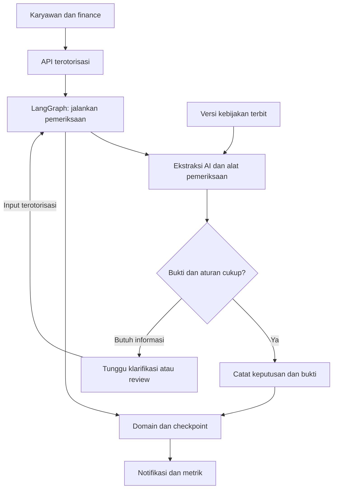

# SDD — Penguatan AI Agent dan Kesiapan Tera

| | |
|---|---|
| Sistem | Tera |
| Berdasarkan | [PRD penguatan AI Agent](2026-10-23-agent-readiness-prd.md), PRODUCT.md, permintaan pengguna 23 Oktober 2026 |
| Versi / tanggal | 1.0 / 23 Oktober 2026 |
| Status | Rancangan siap ditinjau; implementasi menunggu persetujuan rancangan |

## 1. Arsitektur Sistem

Pertahankan SvelteKit, FastAPI, PostgreSQL, dan workflow LangGraph. Pisahkan pekerjaan ke paket yang dapat diuji sendiri. Rancangan berikut adalah target; keberadaan kotak tidak menyatakan fiturnya telah selesai.

Sumber: [Mermaid](../../diagrams/agent-readiness-target.mmd). Hasil render: [SVG](../../diagrams/agent-readiness-target.svg).

| Komponen | Tanggung jawab | Teknologi |
|---|---|---|
| Workflow agent yang ada | Urutan alat, branching, interrupt/resume dan recovery | LangGraph, ClaimProcessingService |
| Pemeriksaan bukti | Ekstraksi AI, validasi nominal, kebijakan, duplikasi, anomali | Service/adapters Python yang ada |
| Penjelasan tindakan | Ringkasan hasil terstruktur, sumber, rule/version, alasan dan tindakan berikut | Kontrak API dan Svelte |
| Evaluator | Dataset sintetis berlabel, eksekusi terisolasi, perbandingan outcome dan laporan | CLI Python dan pytest |
| Notifikasi | Inbox milik pengguna dan pengingat yang mengacu pada status terkini | Repository/service/API/Svelte |
| Kebijakan | Draft, publikasi, tanggal berlaku, versi immutable dan snapshot evaluasi | Repository/service/API/Svelte |
| Pengukuran | Durasi aktif/menunggu, error, usage provider bila tersedia | Peristiwa domain dan reporting |
| Operasi | Build server, migrasi, readiness, backup/restore dan smoke test | Container, PostgreSQL, CI |

### Pilihan pendekatan

| Pendekatan | Konsekuensi | Keputusan |
|---|---|---|
| Perkuat LangGraph yang ada dengan pemilihan tindakan terbatas | Memakai persistence dan batas akses yang sudah ada; lebih mudah diuji dan menjaga perilaku keputusan | Direkomendasikan |
| Tambahkan planner LLM yang memilih alat secara dinamis | Membutuhkan kontrak alat, anggaran langkah, evaluasi prompt injection, dan pembuktian manfaat tambahan | Belum dipilih; tidak diperlukan untuk memenuhi alur agent yang diminta |
| Tulis ulang dengan banyak agent | Memperbesar migrasi dan koordinasi tanpa masalah domain baru yang membutuhkannya | Tidak dipilih |

### Apa yang disebut AI agent dalam rancangan ini

Tujuannya adalah menyelesaikan pemeriksaan klaim. Agent mengamati nota/konteks, menggunakan ekstraksi AI dan alat domain, memilih tindakan sesuai hasil, menunggu manusia bila perlu, melanjutkan dari state tersimpan, dan mencatat hasil. Jenisnya workflow AI agent dengan otonomi terbatas. Keputusan kebijakan tetap mengikuti aturan teruji dan kewenangan reviewer.

LangGraph sendiri bukan bukti penggunaan model. Evaluasi harus membedakan mode mock, live, RAG, serta ML yang benar-benar aktif. Jangan menyebut perencanaan bebas atau tool selection oleh LLM bila implementasi hanya memakai conditional edges deterministik. Penyajian alasan memuat bukti keputusan, bukan chain-of-thought internal model.

### Paket A: nominal, tindakan adaptif, dan evaluasi

1. Audit kontrak ekstraksi dan validation sebelum perubahan. Pertahankan output parsial dan asal data: observasi model, jawaban pengguna, atau keputusan reviewer.
2. Normalisasi nominal dengan konteks format/currency. Kandidat angka bukan bukti bahwa field merupakan total. Ketidaksesuaian subtotal/pajak/diskon/items harus menjadi temuan terstruktur, bukan koreksi perkalian otomatis.
3. Tangani kondisi tanggal/total kurang, hasil ambigu, kebijakan wajib tidak tersedia, provider timeout, dan nota pengganti. Gunakan klarifikasi/review sesuai aturan yang berlaku; provider gagal tidak boleh menghasilkan approve lewat fallback mock dalam mode live.
4. Pertahankan batas retry yang tersedia. Kebuntuan klarifikasi berulang harus berakhir pada eskalasi dengan reason code, bukan loop tanpa batas. Batas putaran dicatat dalam run dan diuji sebelum diaktifkan.
5. Buat evaluator sekurangnya 12 skenario: valid, melampaui batas, duplikat, anomali, nota buram, tanggal hilang, nominal ambigu, subtotal berbeda dari total, currency tidak didukung, kebijakan tidak tersedia, timeout provider, serta resume/replay. Label ditetapkan sebelum eksekusi.
6. Pisahkan evaluasi deterministik workflow dari evaluasi live ekstraksi. Laporan berisi denominators, false approval, hasil per skenario, jumlah intervensi, p50/p95 waktu aktif, error, dan usage/cost bila tersedia. Biaya tidak dihitung bila tarif tidak diberikan/terverifikasi.

### Paket B: notifikasi dan pengukuran

- Tambahkan record notifikasi dengan ID, recipient user ID, claim ID, kind, event key, created/read time. Unik berdasarkan recipient dan event key. Identitas penerima berasal dari domain terverifikasi.
- Simpan event notifikasi bersama mutasi domain bila repository mendukung transaksi; rekonsiliasi idempotent memperbaiki inbox bila langkah terputus. Pembacaan inbox tidak boleh memproses ulang klaim atau memanggil model.
- Notifikasi untuk klarifikasi baru, keputusan final, dan review terbuka. Untuk admin jamak, setiap admin menerima record sendiri. Pengingat default diusulkan setelah 24 jam, maksimal satu per klaim/penerima/hari UTC; hanya ketika status tindakan masih berlaku.
- Endpoint daftar dan tandai dibaca selalu menggunakan identitas sesi. Deep link memeriksa ownership yang sama dengan halaman klaim. Notifikasi lama ditandai terselesaikan ketika tindakan tidak berlaku.
- Pisahkan elapsed sejak pengajuan, waktu aktif run, waktu menunggu karyawan, serta waktu menunggu reviewer. Hindari menjumlah durasi run yang overlap. Data legacy yang tidak cukup diberi null/tidak tersedia.
- Usage model menyimpan model, token counts bila provider menyediakannya, dan status pengukuran. Jangan simpan prompt, nota, token autentikasi, atau raw output. Estimasi lima menit per klaim tetap berlabel asumsi sampai ada baseline manual nyata.

### Paket C: manajemen kebijakan

- Admin membuat draft berisi kategori, sumber teks kebijakan, tanggal berlaku, dan aturan terstruktur yang didukung evaluator. Tidak menerima kode Python, SQL, atau ekspresi executable.
- Publikasi memvalidasi schema, interval berlaku dan konflik. Versi terbit immutable; koreksi membuat versi baru. Publikasi memakai transaksi dan optimistic concurrency agar dua admin tidak saling menimpa.
- Evaluasi memilih versi dari tanggal nota yang tervalidasi. Bila tanggal hilang/ambigu, minta informasi; bila tidak ada versi yang berlaku, teruskan ke review tanpa auto-approve. Simpan version ID/hash dan snapshot rule yang digunakan pada setiap evaluasi.
- Versi pertama mempertahankan perilaku batas per klaim yang sudah ada; aturan agregasi harian/malam tidak ditambahkan secara tersirat.
- Seed kebijakan lokal sebagai versi awal melalui migrasi/import eksplisit yang mempertahankan isi. Keputusan historis tidak dihitung ulang otomatis.
- Indeks RAG memakai fingerprint versi terbit. Indeks usang tidak boleh memakai aturan versi lain. Full-policy evaluator tetap otoritatif; kegagalan retrieval mengikuti fallback yang terdokumentasi atau review jika bukti kebijakan tidak tersedia.

## 2. Deployment & Environment

| Environment | Tujuan | Lokasi/hosting | Akses |
|---|---|---|---|
| Development/test | Regresi terisolasi dan mock | Workspace lokal dan CI | Pengembang |
| Staging | Uji akun nyata, provider live, restart dan restore | Paket container portabel; host/domain belum diberikan | Akun uji yang disetujui |
| Production | Penggunaan setelah penerimaan | Ditetapkan pemilik produk setelah staging lulus | Pengguna terautentikasi |

Siapkan adapter frontend untuk runtime server yang dipilih saat implementasi, container frontend/backend, contoh konfigurasi tanpa secret, readiness, dan langkah migrasi terpisah. Container database lokal yang ada tidak dianggap deployment aplikasi publik. CI frontend menjalankan test/check/build; CI backend tetap menggunakan PostgreSQL dengan pgvector.

Backup mencakup domain, schema migrations, checkpoint, RAG, nota, dan tabel fitur baru. Restore diuji hanya ke database disposable, lalu readiness dan replay klaim sintetis. Catat hasil aktual dan kegagalan; jangan menandai prosedur tertulis sebagai restore berhasil. Rollback frontend/backend harus mempertimbangkan kompatibilitas versi schema dan JSON.

## 3. Alur Data / Sequence (Alur Kritis)

### Pemrosesan dan kelanjutan

API memverifikasi sesi dan ownership, menyimpan bukti, lalu memanggil ClaimProcessingService. Graph menjalankan alat dan menyimpan hasil domain serta marker langkah. Jika informasi kurang, graph menyimpan interrupt dan notifikasi tindakan. Jawaban yang sah menyimpan konteks dan queued run dalam transaksi sebelum resume. Replay membaca hasil yang sudah commit. Review menerapkan keputusan admin tanpa mengulang ekstraksi yang tidak berubah.

### Publikasi kebijakan

Admin memvalidasi draft, menerbitkan versi immutable, lalu menjalankan pembaruan indeks opsional. Klaim baru memilih versi sesuai tanggal bukti. Hasil pemeriksaan menunjuk versi terpilih; versi kebijakan terbaru tidak mengubah keputusan historis. Publikasi yang berkonflik ditolak dengan 409 dan pesan untuk memuat ulang.

### Notifikasi dan laporan

Mutasi status menghasilkan event idempotent; inbox menampilkan hanya item milik sesi. Worker pengingat memeriksa ulang status sebelum mencatat item. Laporan menggabungkan hasil domain dan periode status, tanpa menghitung menunggu manusia sebagai waktu komputasi agent.

## 4. Keamanan

- Pertahankan Clerk JWT dan pemeriksaan admin/ownership backend. Mode demo tetap terisolasi dan tidak diterima sebagai bukti integrasi live.
- Nota sintetis digunakan untuk tes, evaluasi, dan demo. Login nyata dilakukan pengguna melalui UI; password/OTP tidak diminta lewat chat atau dicatat.
- Checkpoint tetap berisi kontrol/ID; data nota, jawaban bebas, secret dan prompt tidak ditambahkan.
- Konten nota/kebijakan diperlakukan sebagai data, tidak boleh mengganti instruksi sistem atau memberi kewenangan alat baru.
- Pengiriman pesan eksternal tidak termasuk paket notifikasi ini. Publikasi aplikasi memerlukan tujuan hosting/domain yang nyata dan konfigurasi akun yang sah.
- Retensi tidak menghapus data otomatis; keputusan retensi, masa simpan backup, dan peserta UAT tetap milik pengguna/organisasi.

## 5. Skala & Performa

Belum ada jumlah pengguna/beban produksi terukur. Uji pagination dengan lebih dari 200 record sintetis, dua worker PostgreSQL pada mutasi bersamaan, serta idempotency untuk pengingat dan publikasi. Gunakan indeks penerima/waktu notifikasi, versi/tanggal kebijakan, dan claim/run sesuai query yang benar-benar dipakai. Ukur latensi p50/p95 pada staging; jangan mengarang SLA.

## 6. Keputusan Desain Penting (ADR Ringkas)

| # | Keputusan | Konteks | Konsekuensi |
|---|---|---|---|
| D-01 | Pertahankan LangGraph | Sudah memiliki interrupt/resume dan durable steps | Hindari migrasi agent yang tidak diperlukan |
| D-02 | Rule engine tetap mengotorisasi keputusan | Nominal dan kebijakan perlu hasil yang dapat diuji | LLM tidak mengabaikan temuan pemblokir |
| D-03 | Notifikasi dalam aplikasi dahulu | Kanal eksternal belum dipilih | Pengguna melihat inbox ketika membuka aplikasi |
| D-04 | Versi kebijakan immutable | Audit keputusan lama harus tetap benar | Publikasi dan migrasi memerlukan tes kompatibilitas |
| D-05 | Deployment portabel | Host/domain belum tersedia | Build bisa disiapkan; URL publik belum dapat dijanjikan |
| D-06 | Bedakan bukti mock, live, dan UAT | Tes lokal tidak membuktikan integrasi atau manfaat pengguna | Laporan menyatakan mode dan batas verifikasi |

## 7. Diagram dan Validasi Rancangan

Diagram menggunakan sumber .mmd dan renderer pretty-mermaid bertema github-light. Diagram menggambarkan komponen target. Detail implementasi mengikuti batas module pada docs/architecture/agent-modules.md.

Urutan implementasi setelah persetujuan: A → B → C → D → E. Setiap paket memiliki perubahan terfokus dan pengujian relevan; paket A memeriksa kontrak sebelum menetapkan migrasi fitur baru. Panduan UAT dapat disiapkan bersamaan, tetapi hasil sesi hanya dicatat setelah peserta menjalankannya.

Definisi selesai seluruh permintaan: kode dan regresi lulus, QA browser selesai, evaluasi live dilaporkan, staging publik terverifikasi, restore terbukti, dan sesi pengguna nyata terdokumentasi. Jika layanan/akun/peserta belum tersedia, tandai item tersebut menunggu input eksternal dan jangan menyebut seluruh pekerjaan selesai.

Pemeriksaan rancangan: scope satu perusahaan konsisten dengan PRODUCT.md; tidak ada angka pelanggan/akurasi/manfaat rekaan; seluruh AR memiliki penerimaan; komponen tambahan jelas ditandai target. Persetujuan yang diminta adalah pendekatan LangGraph terbatas, notifikasi dalam aplikasi, kebijakan berversi, dan urutan paket di atas.
